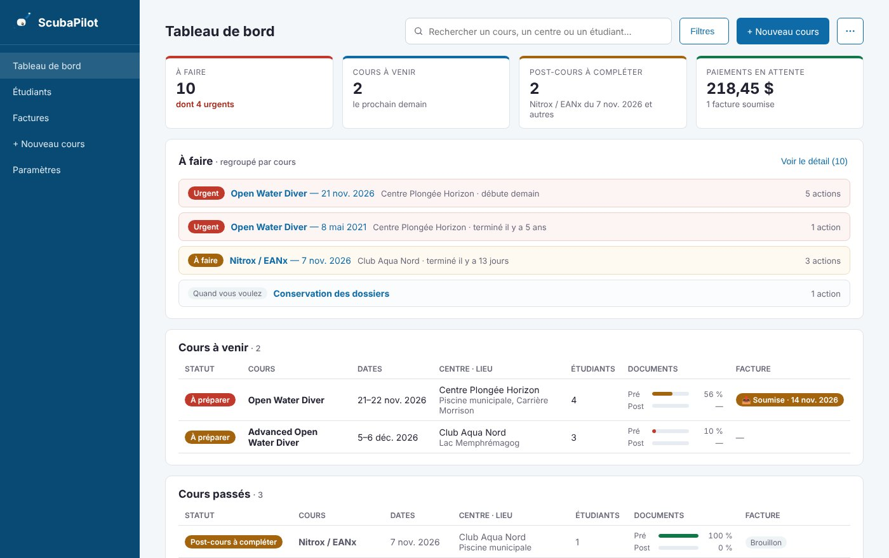
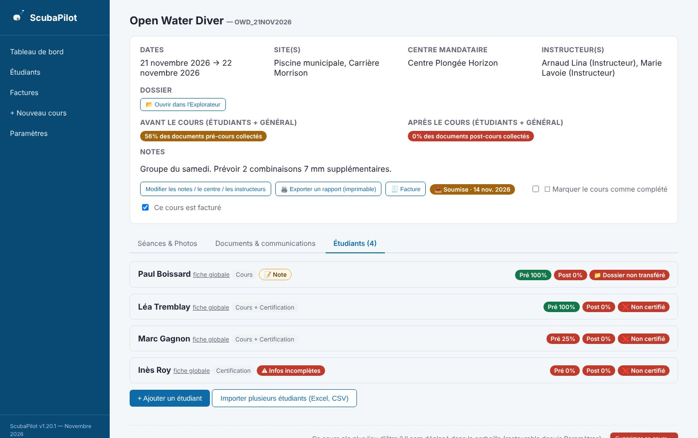
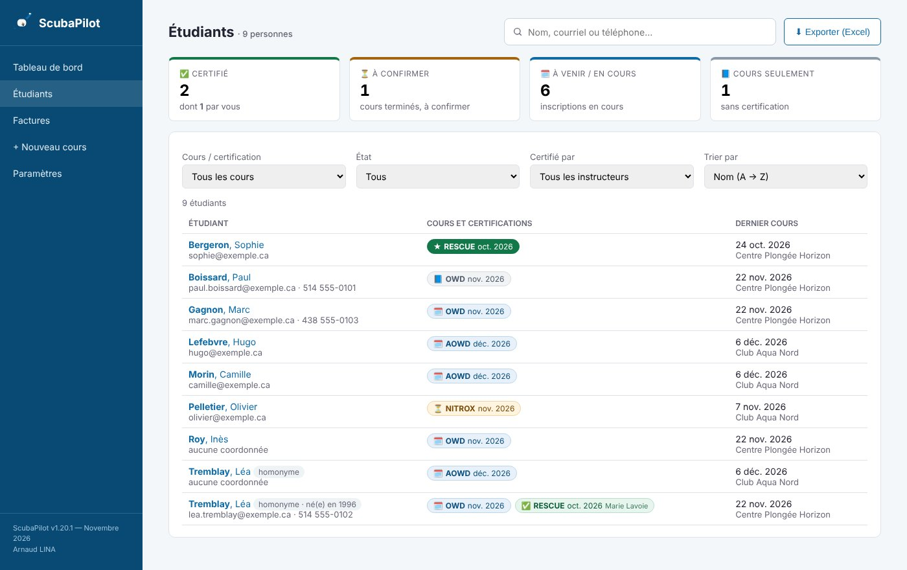
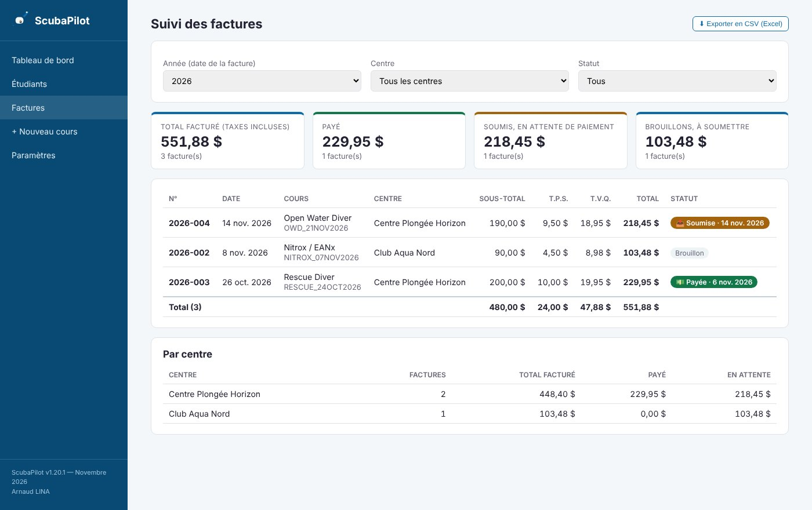
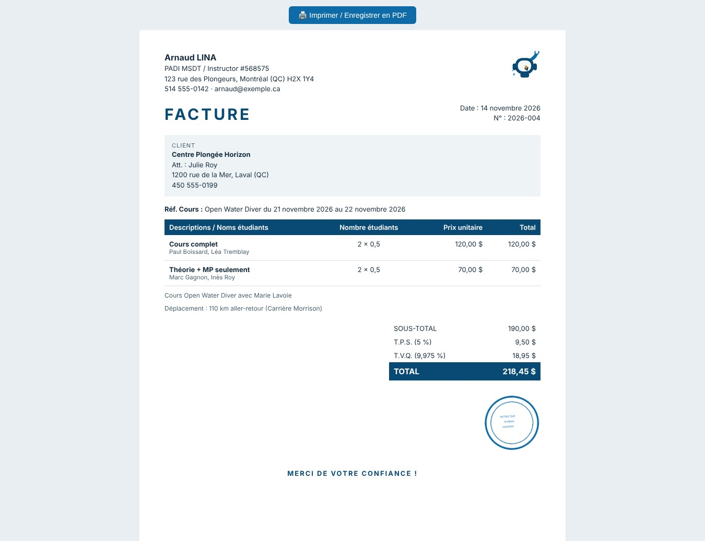
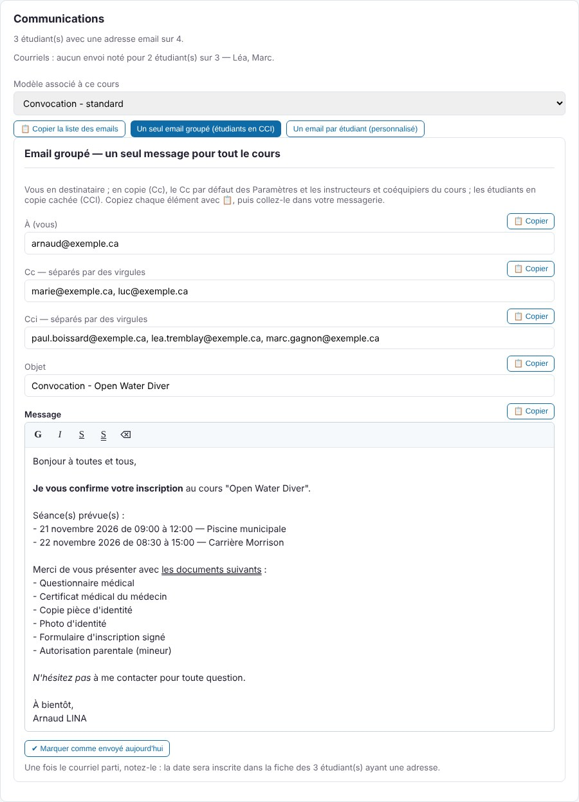

# ScubaPilot

Version 1.21 — Novembre 2026

Application **locale** (aucune donnée envoyée sur internet) pour un instructeur de plongée indépendant : cours, étudiants, checklists de documents, certification, communications et **facturation**.

## Aperçu

*Captures réalisées avec des données de démonstration.*

**Tableau de bord** — chiffres clés, actions « À faire » regroupées par cours, cours à venir et passés

| | |
|---|---|
| **Un cours** — dates, lieux, documents pré/post-cours, étudiants et leur avancement  | **Étudiants** — tous les étudiants, l'état de leurs certifications (★ celles faites par vous)  |
| **Suivi des factures** — brouillons, soumises, payées, totaux par centre, export Excel  | **Facture imprimée** — taxes, étampe, prête à enregistrer en PDF  |
| **Courriel groupé** — Cc, Cci, objet et message mis en forme, prêts à copier dans Outlook ou Gmail  | |

## 📖 Documentation

**➡️ [Guide complet : de l'installation à l'utilisation](docs/GUIDE.md)**  
**📄 [Version PDF illustrée (captures d’écran)](docs/ScubaPilot-Guide-v1.21.pdf)**

Aide-mémoire : [installation](docs/GUIDE.md#2-installation) · [premiers pas](docs/GUIDE.md#4-configuration-initiale-premiers-pas) · [facturation](docs/GUIDE.md#9-facturation) · [sauvegarde](docs/GUIDE.md#13-sauvegarde) · [mise à jour](docs/GUIDE.md#14-mise-à-jour-de-lapplication) · [dépannage](docs/GUIDE.md#15-dépannage)

## Démarrage rapide (Windows)

1. Installez [Node.js](https://nodejs.org/) (LTS, 18 ou plus).
2. Décompressez l'application (ex. `C:\Apps\ScubaPilot`) et lancez `npm install` dans ce dossier.
3. Double-cliquez sur **`Lancer ScubaPilot.bat`** — l'application s'ouvre sur <http://localhost:4531>.
4. Dans **Paramètres** : répertoire racine, vos coordonnées, au moins un centre, vos tarifs. Puis créez votre premier cours.

## Fonctionnalités

Tableau de bord et statuts · cours multi-séances · répertoire des étudiants et fiche globale · checklists (obligatoire / facultatif / conditionnel) · glisser-déposer de documents et photos · emails groupés ou individuels avec modèles et mise en forme · instructeur certificateur et transfert de dossier · **factures** (groupes de tarifs, parts, taxes, étampe, PDF, courriel) · rapports imprimables · sauvegarde .zip.

## Licence et données

Usage personnel. Vos cours et documents restent dans le répertoire racine que vous choisissez ; vos réglages aussi, dans son sous-dossier `_ScubaPilot` (depuis la version 1.8) : une mise à jour consiste à remplacer le dossier de l'application.
