# ScubaPilot — Guide complet

**Version 1.23 — Novembre 2026**

Ce guide accompagne l'utilisateur de l'installation jusqu'à l'utilisation quotidienne : suivi des cours, des étudiants et de leurs documents, communications, certification, facturation, sauvegarde et mises à jour.

## Table des matières

1. [Présentation](#1-présentation)
2. [Installation](#2-installation)
3. [Lancer et arrêter l'application](#3-lancer-et-arrêter-lapplication)
4. [Configuration initiale (premiers pas)](#4-configuration-initiale-premiers-pas)
5. [Utilisation quotidienne](#5-utilisation-quotidienne)
6. [Documents, fichiers et photos](#6-documents-fichiers-et-photos)
7. [Communications (emails)](#7-communications-emails)
8. [Certification et transfert de dossier](#8-certification-et-transfert-de-dossier)
9. [Facturation](#9-facturation)
10. [Rapports et sommaire](#10-rapports-et-sommaire)
11. [Paramètres en détail](#11-paramètres-en-détail)
12. [Organisation des données sur le disque](#12-organisation-des-données-sur-le-disque)
13. [Sauvegarde](#13-sauvegarde)
14. [Mise à jour de l'application](#14-mise-à-jour-de-lapplication)
15. [Dépannage](#15-dépannage)
16. [Notes techniques](#16-notes-techniques)

---

## 1. Présentation

ScubaPilot est une application **locale** : elle tourne sur votre ordinateur et rien n'est envoyé sur internet. Elle sert à gérer l'activité d'un instructeur de plongée indépendant :

- les **cours** (séances, sites, centre mandataire, instructeurs) ;
- les **étudiants** et leurs coordonnées, avec une fiche globale qui suit l'étudiant d'un cours à l'autre ;
- les **checklists de documents** (avant et après le cours) et le pourcentage de complétion ;
- les **communications** (convocations, rappels) ;
- la **certification** (instructeur certificateur) ou le **transfert de dossier** ;
- la **facturation** au centre (aperçu en direct, PDF, courriel) ;
- les **rapports imprimables** et la **sauvegarde**.

L'application s'utilise dans votre navigateur, à l'adresse `http://localhost:4531`. Les données sont de simples fichiers dans des dossiers de votre choix : vous gardez toujours le contrôle.

Hors périmètre : gestion du matériel, des bateaux, de la caisse ou de la location.

## 2. Installation

L'installation se fait une seule fois. L'application est écrite pour **Windows** ; le serveur fonctionne aussi sous macOS et Linux, mais le bouton « Ouvrir dans l'Explorateur », les fichiers de lancement `.bat` et le démarrage automatique sont propres à Windows (voir [Notes techniques](#16-notes-techniques)).

### 2.1 Installer Node.js

1. Allez sur <https://nodejs.org/> et téléchargez la version **LTS** (18 ou plus récente).
2. Lancez l'installateur et gardez les options par défaut.
3. Vérifiez : ouvrez une invite de commande (touche Windows, tapez `cmd`) et tapez `node -v`. Un numéro de version doit s'afficher (ex. `v22.x.x`).

### 2.2 Récupérer l'application

**Option A — téléchargement du zip** (le plus simple) : décompressez le fichier `ScubaPilot-vX.Y.zip` où vous voulez, par exemple `C:\Apps\ScubaPilot`. Choisissez un emplacement qui ne change pas (évitez le dossier Téléchargements).

**Option B — depuis GitHub** (si vous avez Git) :

```
git clone https://github.com/almtlsandbox/scubapilot.git C:\Apps\ScubaPilot
```

Le dépôt est privé : Git vous demandera de vous connecter à votre compte GitHub. Pour mettre à jour plus tard : `git pull`.

### 2.3 Installer les composants

Rien à faire à la main : au premier lancement, **`Lancer ScubaPilot.bat`** installe lui-même les composants nécessaires (il lui faut une connexion Internet, quelques secondes). Un dossier `node_modules` apparaît : c'est normal.

Si vous préférez le faire vous-même : ouvrez une invite de commande dans le dossier de l'application et tapez `npm install`.

## 3. Lancer et arrêter l'application

### Lancer

Double-cliquez sur **`Lancer ScubaPilot.bat`**. ScubaPilot démarre en arrière-plan (sans fenêtre à garder ouverte) et votre navigateur s'ouvre sur l'application. Au premier lancement après une installation ou une mise à jour, ce fichier installe aussi les composants nécessaires (`npm install`), ce qui demande une connexion Internet.

- **Une seule copie à la fois.** Si ScubaPilot tourne déjà, le lancement ouvre simplement la page.
- **C'est toujours la copie que vous lancez qui tourne.** Si une autre copie est en marche (un ancien dossier, ou l'ancienne version restée en mémoire après une mise à jour), elle est arrêtée et remplacée, et un message vous le signale.
- Si le port 4531 est pris par un autre programme, un message clair l'indique.

L'ancien fichier `Lancer (avec fenetre).bat` est conservé pour vos raccourcis existants : il fait la même chose.

### Démarrage automatique à l'ouverture de session

Double-cliquez sur **`Installer le demarrage automatique.bat`**. Un petit fichier `ScubaPilot.cmd` est créé dans le dossier « Démarrage » de Windows ; tout ancien lancement de ScubaPilot qui s'y trouvait (y compris un raccourci vers `Demarrage-automatique.vbs`, même depuis un autre dossier) est retiré. À chaque ouverture de session, l'application démarre toute seule : une fenêtre réduite apparaît une ou deux secondes dans la barre des tâches, puis disparaît. Ouvrez ensuite simplement `http://localhost:4531` (ajoutez-le aux favoris).

Cette installation n'utilise ni PowerShell, ni le registre, ni VBScript, pour ne pas déclencher les antivirus. Si vous déplacez le dossier de l'application, relancez-la.

Pour l'enlever : **`Retirer le demarrage automatique.bat`**.

> `Demarrage-automatique.vbs` reste présent pour les anciens raccourcis, mais VBScript est en cours de retrait de Windows : passez au nouveau raccourci avec le fichier ci-dessus.

### Arrêter

Double-cliquez sur **`Arreter.bat`** (par exemple avant une mise à jour).

### Journal

En cas de souci, consultez `app.log` dans le dossier de l'application (son chemin est rappelé dans **Paramètres → Emplacements**). Il est archivé en `app.log.1` quand il dépasse 1 Mo.

Le numéro de version est affiché en bas de la barre latérale (par exemple « ScubaPilot v1.9 »).

## 4. Configuration initiale (premiers pas)

Faites ces étapes dans l'ordre la première fois (menu **Paramètres**).


*Paramètres : répertoire racine, emplacements, sauvegarde, corbeille et vos coordonnées*

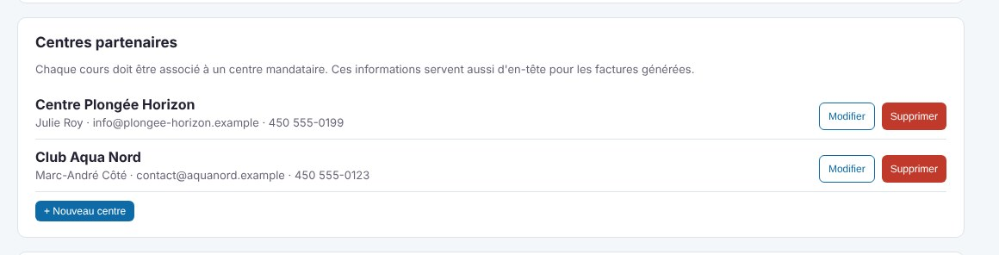
*Paramètres : centres partenaires*


1. **Répertoire racine** — Indiquez le dossier où seront rangés tous vos cours et documents (ex. `D:\Plongee\Instructeur`). Cliquez sur « Créer si absent » s'il n'existe pas encore. Choisissez un dossier que vous sauvegardez régulièrement.
2. **Vos coordonnées** — Nom, numéro PADI (ex. `PADI MSDT / Instructor #568575`), **adresse**, téléphone, courriel. Ces informations servent aux emails et à l'en-tête des factures. C'est aussi ici que vous réglez vos CC/BCC par défaut pour l'email groupé.
3. **Centres partenaires** — Ajoutez au moins un centre (nom, contact, adresse, courriel, téléphone, n° de taxe ou référence). **Un centre est obligatoire pour créer un cours.**
4. **Coéquipiers** — Ajoutez les personnes avec qui vous travaillez (nom, rôle, courriel). Un collègue instructeur est un coéquipier de rôle « Instructeur » : cette liste sert aussi à choisir l'instructeur certificateur.
5. **Types de cours, sites de plongée, champs du profil étudiant, modèles d'email** — Vérifiez les valeurs par défaut et adaptez-les (voir [section 11](#11-paramètres-en-détail)).
6. **Facturation** — Réglez la devise, les taxes, le pied de page, ajoutez l'image de votre **étampe** et créez vos **grilles de tarifs** (voir [section 9](#9-facturation)).

Vous êtes prêt : créez votre premier cours.

## 5. Utilisation quotidienne

### 5.1 Tableau de bord

Page d'accueil. Depuis la version 1.18, elle va à l'essentiel : une ligne d'en-tête, quatre chiffres clés, la liste **« À faire »** regroupée par cours, puis les cours à venir et les cours passés récents.

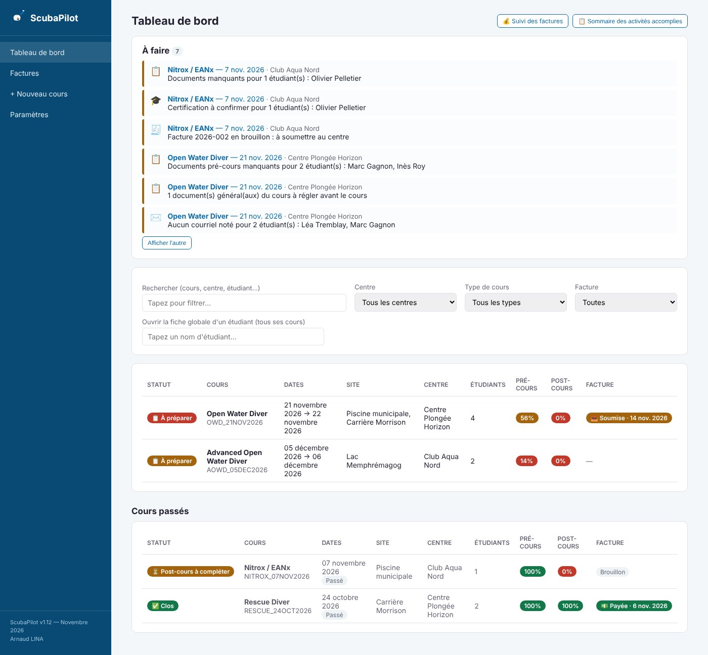
*Le tableau de bord*

#### L'en-tête

- **Recherche** (« Rechercher un cours, un centre ou un étudiant ») : filtre les listes de cours au fil de la frappe (type de cours, centre, nom d'étudiant). Dès deux lettres, une petite liste propose aussi la **fiche globale** des étudiants qui correspondent (voir [5.7](#57-la-fiche-étudiant-globale)) ; flèche bas pour y descendre, Entrée pour l'ouvrir, Échap pour la fermer.
- **Filtres** : déplie les filtres par **centre**, par **type de cours** et par **état de la facture** (sans facture, non facturé, brouillon, soumise, payée). Une pastille indique combien de filtres sont actifs ; « Effacer les filtres » les remet à zéro.
- **+ Nouveau cours** : crée un cours (voir [5.2](#52-créer-un-cours)).
- **⋯** (autres actions) : **Calendrier des cours à venir (.ics)** et **Sommaire des activités accomplies** (voir [section 10](#10-rapports-et-sommaire)).

Le suivi des factures se trouve dans le menu **Factures** à gauche (voir [9.6](#96-suivi-des-factures-et-export)).

#### Les chiffres clés

| Tuile | Ce qu'elle compte |
|---|---|
| **À faire** | le nombre d'actions de la liste « À faire », dont combien sont **urgentes** (en rouge) |
| **Cours à venir** | les cours pas encore terminés, et dans combien de jours débute le prochain |
| **Post-cours à compléter** | les cours terminés dont des documents manquent encore (le plus récent est nommé) |
| **Paiements en attente** | le total des factures soumises et pas encore payées ; un clic ouvre la page **Factures** |

#### La liste « À faire »

ScubaPilot rassemble ce qui demande une action, **une ligne par cours** : la mention **Urgent** (rouge) ou **À faire** (orange), le cours (lien vers sa fiche), le centre, le moment (« débute dans 2 jours », « terminé il y a 12 jours ») et le nombre d'actions. Les sujets qui ne concernent pas un cours précis ont leur propre ligne : **Sauvegarde**, **Copie en conflit (OneDrive)** dans les réglages, **Conservation des dossiers**.

La liste est repliée par défaut. **Voir le détail** affiche, sous chaque ligne, les actions elles-mêmes :

- 📋 **documents pré-cours manquants** pour un cours qui débute dans les 14 jours (ou en cours), étudiants nommés ;
- ✉️ **aucun courriel noté** pour certains étudiants d'un cours qui débute dans les 14 jours (voir [7.3](#73-garder-la-trace-des-envois)) ;
- 📋 🎓 📁 pour un cours terminé : **documents manquants**, **certifications à confirmer**, **dossiers à transférer** — ou 🔷 « vous pouvez clôturer ce cours » quand tout est complet ;
- 🧾 **facture à préparer** ou **en brouillon à soumettre** pour un cours terminé ;
- 💵 **paiement en attente**, avec le nombre de jours et le montant ;
- copie en conflit créée par OneDrive, avec le bouton **Ouvrir le dossier**.

Une ligne est **Urgent** quand l'échéance est proche (cours dans 3 jours ou moins) ou dépassée de plus de 30 jours. Les lignes urgentes viennent en premier. **Replier** referme le détail.

#### Les listes de cours

- **Cours à venir** : le prochain cours en haut, du plus proche au plus lointain ; les cours sans séance planifiée viennent à la fin ;
- **Cours passés** : du plus récent au plus ancien, grisés. Seuls les **5 plus récents** sont montrés ; **Voir les N autres** affiche le reste. Pendant une recherche ou avec un filtre, tous les cours qui correspondent sont montrés. Un cours est « passé » quand sa dernière séance est antérieure à aujourd'hui.

Colonnes : **Statut**, **Cours**, **Dates** (en abrégé : « 21–22 nov. 2026 »), **Centre · lieu**, **Étudiants**, **Documents** (deux barres : pré-cours et post-cours, avec le pourcentage ; « — » pour le post-cours d'un cours qui n'a pas commencé) et **Facture**. Un clic sur une ligne ouvre le cours.

Le **Statut** tient compte des **dates** : un cours à venir n'est jugé que sur ses documents pré-cours.

| Statut | Signification |
|---|---|
| 📝 À planifier | Aucune séance n'est planifiée |
| 📋 À préparer | Le cours est à venir et des documents pré-cours manquent (orange ; **rouge** à 7 jours ou moins du début) |
| 🗓️ Prêt | Le cours est à venir et les documents pré-cours sont complets |
| ▶️ En cours | Aujourd'hui se situe entre la première et la dernière séance |
| ⏳ Post-cours à compléter | Le cours est terminé et des documents manquent (orange ; **rouge** après 30 jours) |
| 🔷 Prêt à clôturer | Le cours est terminé, tous les documents sont à 100 %, mais il n'est pas encore marqué complété |
| ✅ Clos | Le cours a été marqué complété manuellement |

Survolez un statut pour voir le détail (« Débute dans 7 jours — documents pré-cours incomplets (56 %) »).

> **Tablette, téléphone, fenêtre étroite** : sous 900 pixels de large, le menu de gauche se replie derrière le bouton **☰** en haut à gauche, la recherche passe sur sa propre ligne, les chiffres clés sur deux colonnes, les formulaires sur une colonne et les tableaux trop larges défilent horizontalement dans leur carte.

### 5.2 Créer un cours

Menu **+ Nouveau cours** :


*Le formulaire de nouveau cours*


1. Choisissez le **type de cours** (OWD, Rescue, etc.).
2. Choisissez le **centre mandataire** (obligatoire).
3. Entrez la **date** de la première séance, l'heure et le site.
   - **Date** : tapez les 8 chiffres à la suite (`17102026` devient `17/10/2026`, les `/` s'insèrent seuls) **ou** cliquez sur le bouton 📅 à droite du champ pour choisir dans un petit calendrier.
   - **Heure** : format 24 h. Tapez par exemple `930` (devient `09:30`) ou `9` (devient `09:00`), ou cliquez dans le champ pour choisir parmi les suggestions toutes les 15 minutes (de 06:00 à 22:00). Une heure invalide est effacée.
4. Cochez les **instructeurs** rattachés au cours (parmi vos coéquipiers).
5. Choisissez au besoin un **modèle d'email** par défaut et ajoutez des notes.

Les champs obligatoires sont marqués d'un astérisque. S'il en manque un, il est **encadré en rouge**, le curseur s'y place et un message indique quoi corriger.

Le cours est créé dans votre répertoire racine sous le nom `TYPE_DATE` (ex. `OWD_03OCT2026`), avec un sous-dossier `Photo`.

### 5.3 La fiche d'un cours

En haut : dates, sites, centre, instructeurs, dossier, pourcentages globaux de documents pré/post-cours et les actions (modifier, exporter le rapport, **🧾 Facture**, marquer complété). Le bouton **Supprimer ce cours…** est volontairement à l'écart, tout en bas de la page. Dessous, trois onglets (l'onglet actif est conservé lors des rafraîchissements) :


*Fiche de cours : onglet Séances & Photos*


*Fiche de cours : onglet Documents & communications*

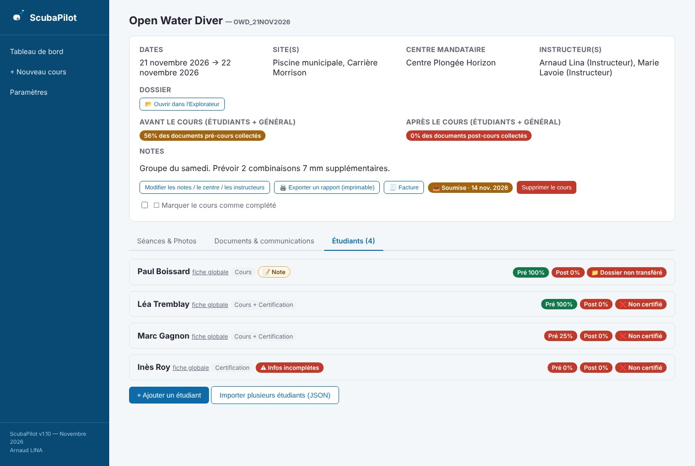
*Fiche de cours : onglet Étudiants*


**Séances & Photos**
- Un cours peut avoir **plusieurs séances** (théorie, piscine, fosse, mer…), chacune avec date, heure de début, heure de fin, site et notes. La **durée** est calculée automatiquement et la durée totale du cours s'affiche en haut.
- Tous les champs sont modifiables directement dans le tableau : la valeur s'enregistre toute seule (un changement de date recharge la page pour retrier).
- Sur chaque séance, ajoutez des **coéquipiers** via le menu « + ajouter… ». Il ne propose que les **instructeurs et coéquipiers choisis pour ce cours** (bouton « Modifier les notes / le centre / les instructeurs »), sans vous-même ; pour en proposer un autre, ajoutez-le d'abord au cours ; leur courriel est mis en copie (Cc) des courriels du cours, comme celui des instructeurs rattachés au cours.
- **📅 Ajouter au calendrier** : enregistre un fichier `.ics` contenant une entrée par séance (heures, lieu, coéquipiers, notes). Ouvrez-le pour l'ajouter à Outlook, Google Agenda ou au Calendrier d'Apple. Sans heure de début, la séance est inscrite sur la journée entière. Le tableau de bord propose la même chose pour toutes les séances à venir d'un coup : menu **⋯ → Calendrier des cours à venir (.ics)**.
- La carte **Photos du cours** reçoit vos photos par glisser-déposer.

**Documents & communications**
- **Documents généraux du cours** (assurance transmise au centre, feuille de présence…) : checklist définie par le type de cours.
- **Communications** : génération des emails (voir [section 7](#7-communications-emails)).

**Étudiants**
- Liste des étudiants avec leur checklist, leurs coordonnées et leur statut (voir ci-dessous).

### 5.4 Ajouter des étudiants

Dans l'onglet **Étudiants** :

- **Ajouter un étudiant** : remplissez le formulaire (prénom et nom obligatoires). Un dossier `Prénom NOM` est créé dans le dossier du cours. Si l'étudiant a déjà suivi un cours, **recherchez-le par nom** : ses coordonnées sont copiées depuis son cours précédent.
- **Importer plusieurs étudiants (Excel, CSV)** : voir [5.9](#59-importer-plusieurs-étudiants-excel-csv).
- **Deux étudiants du même nom dans un cours** : si le nom est déjà pris dans ce cours, ScubaPilot demande s'il s'agit d'une autre personne. Sur confirmation, un second dossier est créé (`Prénom NOM (2)`) et une étiquette « homonyme » permet de les distinguer dans la liste.

### 5.5 La fiche d'un étudiant (dans un cours)

Dépliez l'étudiant pour voir :

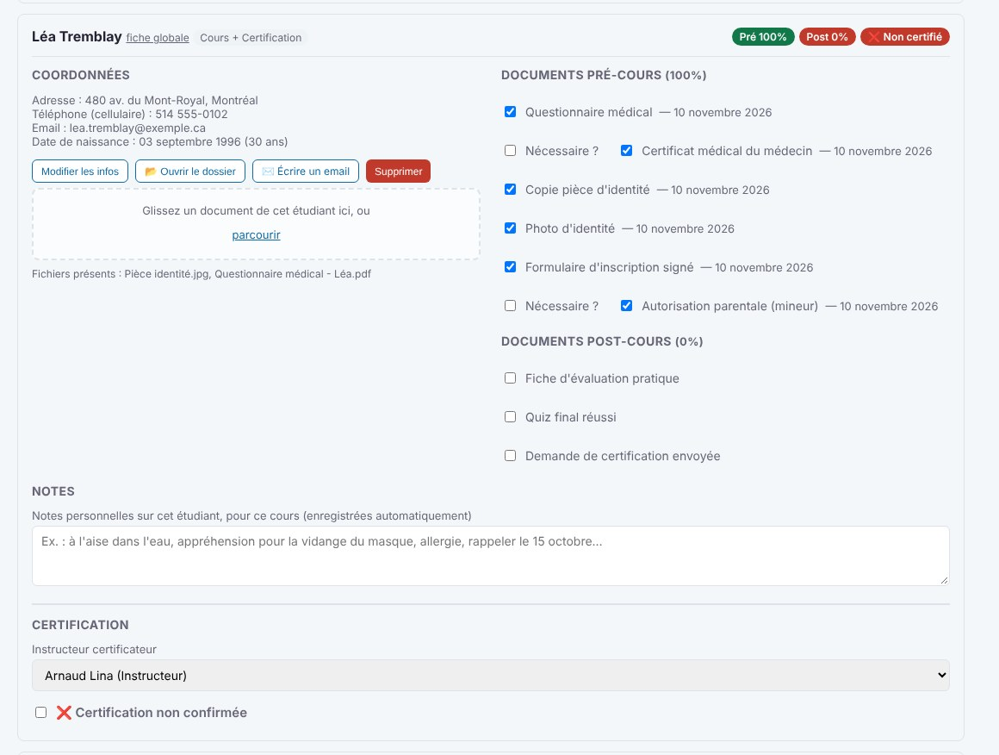
*Étudiant avec certification : instructeur certificateur et certification confirmée*

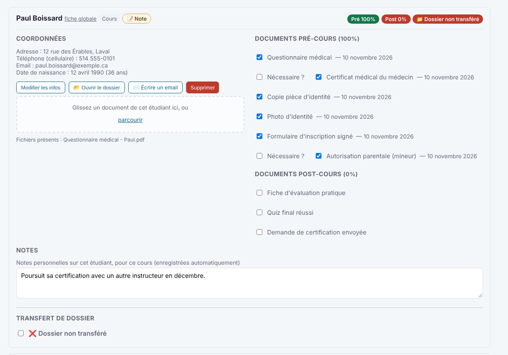
*Étudiant « cours seulement » : transfert de dossier*


- ses **coordonnées**, son **âge** calculé à partir de la date de naissance, et son **statut** : *Cours seulement*, *Certification* ou *Cours + Certification* (les libellés sont modifiables dans Paramètres) ;
- un badge **⚠ Infos incomplètes** s'il manque un téléphone, un courriel ou une date de naissance (survolez le badge pour voir quoi) ;
- la **checklist pré-cours et post-cours** : cochez les cases au fur et à mesure (vous pouvez enchaîner les clics sans rechargement). Une date est enregistrée à chaque réception ;
- la zone de **dépôt de fichiers**, le bouton **📂 Ouvrir dans l'Explorateur** et le bouton **✉️ Email à copier** ;
- une zone **Notes** : texte libre propre à cet étudiant pour ce cours (observations, appréhensions, allergies, rappels à faire…). Elle s'enregistre automatiquement après une courte pause de frappe ou quand vous quittez le champ (indication « ✓ Enregistré »). Un badge **📝 Note** apparaît dans l'en-tête de l'étudiant dès qu'une note existe ; la note figure aussi sur le **rapport de cours** et dans l'**historique de la fiche globale** ;
- la section **Certification** ou **Transfert de dossier** (voir [section 8](#8-certification-et-transfert-de-dossier)) ;
- le lien **fiche globale**.

### 5.6 Statuts de documents et pourcentages

Chaque document d'une checklist est :

- **obligatoire** (`required`) : toujours compté dans le pourcentage ;
- **facultatif** (`optional`) : jamais compté (informatif) ;
- **conditionnel — coché à la main** (`conditional`) : un interrupteur **« Nécessaire ? »** apparaît pour chaque étudiant. Le document ne compte que si l'interrupteur est activé (par exemple un billet du médecin selon les réponses au questionnaire médical) ;
- **automatique — âge / statut** (`rule`) : ScubaPilot décide lui-même, pour chaque étudiant, si le document est nécessaire, selon une **règle** choisie dans le modèle de cours :
  - **l'étudiant a moins de N ans au début du cours** (âge calculé avec sa date de naissance et la première séance) — par exemple la **signature parentale** pour les moins de 18 ans ;
  - **son statut est** l'un de ceux cochés (Cours, Certification, Cours + Certification) — par exemple la **photo ID PADI** seulement pour « Certification » et « Cours + Certification » ;
  - les deux à la fois si vous cochez les deux conditions.

  Dans la fiche de l'étudiant, le document porte une étiquette **nécessaire** (bleue) ou **non nécessaire** (grise) avec la raison (« 15 ans », « Cours + Certification »). Un document non nécessaire ne compte pas dans les pourcentages, n'apparaît pas dans `{liste_docs_manquants}` et figure comme « non nécessaire » dans le rapport. **Sans date de naissance**, une règle d'âge considère le document comme nécessaire, pour ne pas l'oublier. Changer la date de naissance ou le statut d'un étudiant met tout à jour.

Les pourcentages « Pré » et « Post » sont calculés à partir de la liste des documents du type de cours : un document ajouté plus tard au type apparaît donc correctement comme manquant chez les étudiants existants.

### 5.7 La fiche étudiant globale

#### Tous les étudiants : le menu « Étudiants »

Le menu **Étudiants** (à gauche) liste toutes les personnes de tous vos cours, une ligne par personne :

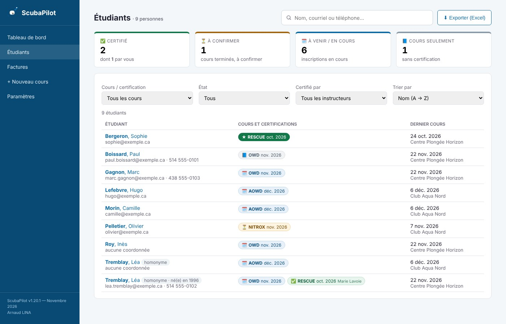
*Le répertoire des étudiants*

- son **nom** (lien vers sa fiche globale), son courriel et son téléphone ; la mention **homonyme** signale deux personnes de même nom ;
- **ses cours et certifications**, une pastille par cours, du plus récent au plus ancien : ✅ **certifié** (vert), ⏳ **à confirmer** (orange : cours terminé, certification pas encore confirmée), 🗓️ **à venir ou en cours** (bleu), 📘 **cours seulement** (gris). Survolez une pastille pour le détail (date, instructeur certificateur, transfert du dossier) ; un clic ouvre le cours ;
- la date et le centre de son **dernier cours**.

Les certifications **faites par vous** se distinguent : leur pastille est **vert plein avec une ★** ; celles d'un autre instructeur restent vert pâle, avec son nom. Le filtre **Certifié par** montre soit vos certifications (« Moi »), soit celles d'un autre instructeur, et la tuile « Certifié » indique combien sont de vous. ScubaPilot vous reconnaît dans la liste des coéquipiers par le **nom** ou le **courriel** de vos coordonnées (Paramètres) : ajoutez-vous comme coéquipier et choisissez-vous comme instructeur certificateur dans la fiche de l'étudiant.

Les quatre tuiles du haut comptent les cours dans chaque état ; un clic sur une tuile filtre la liste (un deuxième clic retire le filtre). Vous pouvez aussi **rechercher** (nom, courriel, téléphone), filtrer par **cours / certification** (ex. tous les Open Water certifiés : choisissez Open Water Diver et l'état Certifié), par **certificateur** et **trier** par nom ou par cours le plus récent. **⬇ Exporter (Excel)** enregistre la liste affichée en CSV (coordonnées, certifications confirmées, à confirmer, etc.).

Un clic sur une ligne ouvre la **fiche globale** de la personne.

#### La fiche globale

Un même étudiant peut suivre plusieurs cours. Sa **fiche globale** (menu Étudiants, lien à côté de son nom dans un cours, ou recherche du tableau de bord) réunit :

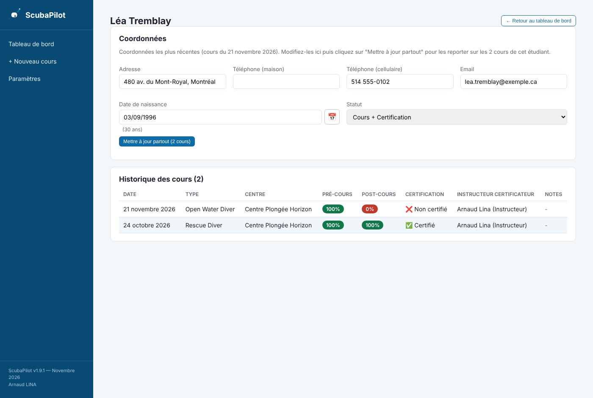
*La fiche étudiant globale*


- l'**historique** de tous ses cours (date, type, centre, % pré/post, certification ou transfert, instructeur certificateur), cliquable ;
- son **nom**, que vous pouvez corriger : le bouton **Renommer** renomme son dossier dans chacun de ses cours, avec ses documents (la facture du cours suit) ;
- ses **coordonnées** les plus récentes. Le bouton **« Mettre à jour partout »** reporte une correction (ex. un nouveau numéro de téléphone) dans le dossier de l'étudiant de chacun de ses cours. Le statut (cours, certification) reste propre à chaque cours.

#### Comment ScubaPilot reconnaît une personne

Chaque étudiant a un **identifiant** invisible, inscrit dans sa fiche. Deux fiches de cours différents appartiennent à la même personne quand elles portent le même identifiant.

- **À l'inscription**, un étudiant est reconnu s'il porte le **même prénom et le même nom** (majuscules et accents ignorés) **et** le **même courriel ou la même date de naissance** qu'une fiche existante. Sinon, c'est une nouvelle personne. Choisir l'étudiant dans la recherche « étudiant existant » le rattache à coup sûr.
- **Deux homonymes restent séparés.** Quand une autre fiche porte le même nom, un encadré le signale en haut de la fiche globale : si c'est la même personne (par exemple un courriel manquant d'un côté), cliquez sur **« C'est la même personne : fusionner »**.
- **Un cours rattaché par erreur ?** Dans l'historique, le bouton **Détacher** le sort de la fiche : il devient la fiche d'une autre personne. Rien n'est supprimé.

**Passage à la version 1.15.** Au premier démarrage, ScubaPilot attribue un identifiant à toutes vos fiches existantes, selon la même règle. Rien d'autre n'est modifié, et une copie des fiches d'origine est rangée dans `_ScubaPilot/_avant-identifiants-…` du répertoire racine. Deux fiches au même nom sans courriel ni date de naissance en commun deviennent deux personnes : parcourez les encadrés « même nom » pour fusionner celles qui sont en réalité la même.

### 5.8 Clore et supprimer

- **Marquer un cours comme complété** : case en bas à droite de la carte du cours. Un badge ✅ Clos apparaît à côté du titre.
- **Supprimer un cours ou un étudiant** le déplace dans la **corbeille** de ScubaPilot, avec tous ses documents (voir [Corbeille](#corbeille)). Il faut **retaper le nom exact** dans la fenêtre de confirmation avant que le bouton ne s'active.

### 5.9 Importer plusieurs étudiants (Excel, CSV)

Sur la fiche du cours, onglet Étudiants, cliquez sur **« Importer plusieurs étudiants (Excel, CSV) »** :

1. Dans Excel (ou Google Sheets), sélectionnez les lignes de vos étudiants, avec ou sans la ligne de titres, et copiez (Ctrl+C). Collez dans la zone de texte (Ctrl+V). Vous pouvez aussi **choisir un fichier .csv** (les accents des fichiers enregistrés par Excel sont reconnus).
2. ScubaPilot affiche un **aperçu** et devine le contenu de chaque colonne : prénom, nom, nom complet (« Prénom Nom » ou « Nom, Prénom »), email, téléphones, adresse, date de naissance (`JJ/MM/AAAA` ou `AAAA-MM-JJ`), statut. Corrigez au besoin avec la liste au-dessus de chaque colonne ; une colonne « ignorée » est barrée.
3. Les lignes sans prénom ou sans nom sont signalées en rouge et laissées de côté.
4. Cliquez sur **Importer N étudiant(s)**. Les étudiants et leurs dossiers sont créés ; les doublons (même prénom et nom dans ce cours) sont ignorés et listés.

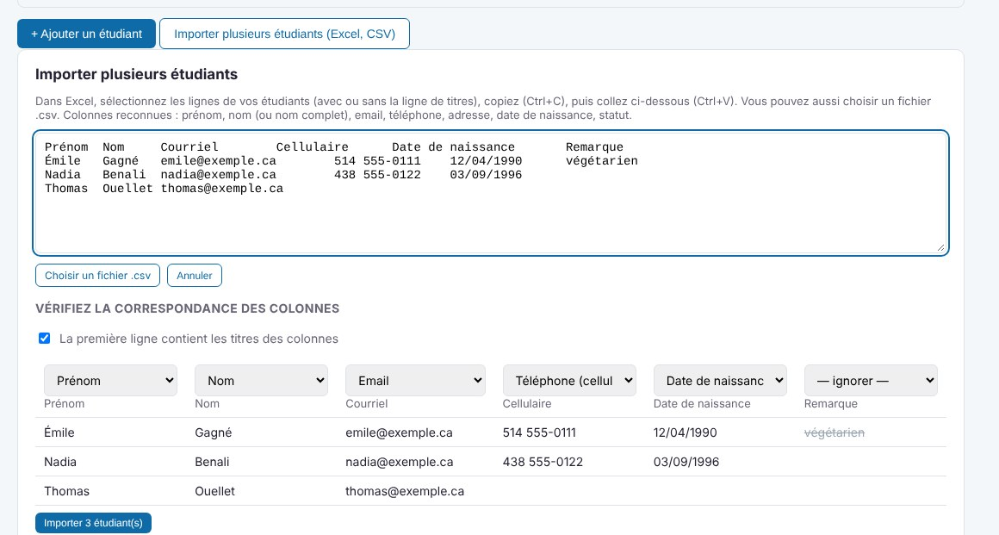
*Import d'étudiants : aperçu et correspondance des colonnes*

Un roster en PDF ? Demandez à un assistant (Claude, par exemple) d'en faire un tableau, puis collez-le. L'ancien format JSON reste accepté dans la même zone de texte.

## 6. Documents, fichiers et photos

Trois zones acceptent le **glisser-déposer** (ou le bouton « parcourir », avec sélection multiple) :

| Zone | Où le fichier est copié |
|---|---|
| Documents généraux du cours | Dossier du cours |
| Fiche d'un étudiant | Dossier de l'étudiant |
| Photos du cours | Sous-dossier `Photo` du cours (créé automatiquement, même pour les anciens cours) |

Si un fichier du même nom existe déjà, une copie `nom (2).ext` est créée : jamais d'écrasement. La liste des fichiers réellement présents se met à jour immédiatement.

Vous pouvez aussi déposer vos scans directement dans les dossiers via l'Explorateur Windows (bouton **📂 Ouvrir dans l'Explorateur** sur chaque cours et chaque étudiant).

## 7. Communications (emails)

L'application n'envoie pas de courriel elle-même et n'ouvre aucun logiciel de messagerie : elle **prépare** le message, et vous le **copiez-collez** dans la messagerie de votre choix (Gmail, Outlook...). Chaque élément du courriel (adresses, objet, message) a son bouton **📋 Copier**, qui passe au vert « Copié » une fois le texte dans le presse-papiers. Vous pouvez retoucher un champ avant de le copier : c'est le texte affiché qui est copié.

### 7.1 Deux façons d'écrire

- **Un email groupé** : un seul message, adressé à vous-même (« À »). En **copie (Cc)** : le Cc par défaut des Paramètres (ex. le centre) et les **instructeurs et coéquipiers du cours** (les instructeurs rattachés au cours et les coéquipiers des séances, sauf vous). En **copie cachée (Cci)** : tous les étudiants du cours et votre Cci par défaut. Comme le message n'est pas personnalisé (« Bonjour {prenom}, » y devient simplement « Bonjour, »), `{prenom}`, `{nom}` et `{liste_docs_manquants}` restent vides ; un avertissement orange le rappelle quand le modèle les contient. **`{prenom}` et `{nom}` désignent toujours l'étudiant** : pour vous nommer, utilisez `{instructeur}` ; pour nommer toute l'équipe, `{equipe}`.
- **Un email par étudiant** : un message distinct avec ses documents manquants, chacun avec ses boutons 📋 pour l'adresse, la copie (Cc : instructeurs et coéquipiers du cours), l'objet et le message. Utile pour les relances. Le bouton **✉️ Email à copier** de la fiche d'un étudiant ouvre la même chose pour un seul étudiant (objet et message préremplis si le cours a un modèle associé).

Le bouton **📋 Copier la liste des emails** copie d'un coup les adresses de tous les étudiants du cours, séparées par des virgules.

Pour l'email groupé, l'ordre habituel est : copier le champ **Cc**, puis **Cci**, et les coller dans les champs correspondants de votre messagerie, puis l'**objet**, puis le **message**.

Le **message** garde sa **mise en forme** (gras, italique, souligné, double souligné) : le bouton 📋 la copie avec le texte, et elle réapparaît au collage dans Outlook ou Gmail. Vous pouvez aussi retoucher le message et sa mise en forme avant de le copier, avec la petite barre d'outils au-dessus du texte.

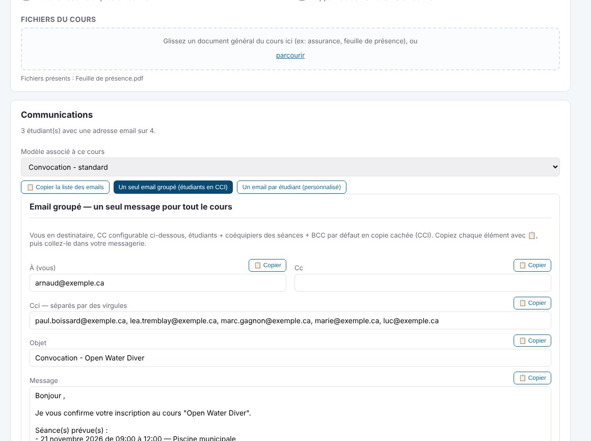
*L'email groupé : chaque champ a son bouton « Copier »*

### 7.2 Modèles d'email

Dans **Paramètres → Modèles d'email**, vous gérez une bibliothèque de modèles nommés, aussi nombreux que vous voulez. Chaque cours a un **modèle par défaut** (choisi à la création, modifiable dans la carte « Communications » : enregistré automatiquement).

Le **message** d'un modèle peut être mis en forme : sélectionnez du texte, puis cliquez sur **G** (gras), ***I*** (italique), **S** souligné, **S** double souligné, ou **⌫** pour retirer la mise en forme de la sélection. Les raccourcis Ctrl+B, Ctrl+I et Ctrl+U fonctionnent aussi. Un texte collé depuis Word ou un courriel garde ces quatre mises en forme ; le reste (polices, couleurs, tailles) est retiré, pour que le message s'affiche proprement partout.

Variables disponibles dans le sujet et le corps :

| Variable | Contenu |
|---|---|
| `{type_cours}` | Nom du type de cours |
| `{prenom}`, `{nom}` | **L'étudiant** (email individuel ; vides dans l'email groupé) |
| `{liste_docs_pre}` | Documents pré-cours à apporter |
| `{liste_docs_manquants}` | Documents manquants de l'étudiant |
| `{liste_etudiants}` | Noms de tous les étudiants (email groupé seulement) |
| `{liste_dates_lieux}` | Séances : date, heure, lieu |
| `{liste_dates_lieux_note_coequipier}` | Version narrative : « Rendez-vous le [date] à [heure], [lieu], [notes], et nous serons accompagnés de [coéquipiers] » |
| `{liste_lieux_adresses}` | Les lieux du cours avec leur adresse complète, chacun une seule fois : « - Boutique SubAquaTech : 7195 Chemin Chambly, St-Hubert » |
| `{date_debut}`, `{date_fin}`, `{lieu}` | Format simple |
| `{instructeur}`, `{instructeur_padi}`, `{instructeur_tel}` | Vos coordonnées (signature) — `{instructeur}` est votre nom |
| `{equipe}` | Vous et les instructeurs et coéquipiers du cours : « Arnaud LINA, Karim Ait Oumeziane et Martin Chamberland » |

### 7.3 Garder la trace des envois

Comme ScubaPilot n'envoie rien lui-même, c'est vous qui lui dites qu'un courriel est parti : cliquez sur **✔ Marquer comme envoyé** (sous l'email groupé, sous chaque email individuel, ou dans la fenêtre « Email à copier » d'un étudiant). La date du jour et le modèle utilisé sont alors notés dans la fiche de chaque étudiant concerné.

- Dans la fiche d'un étudiant, une ligne indique le **dernier courriel noté** ; survolez-la pour voir l'historique.
- La carte « Communications » résume pour quels étudiants aucun envoi n'est noté.
- La liste « À faire » du tableau de bord signale les cours proches dont certains étudiants n'ont reçu aucun courriel noté.

## 8. Certification et transfert de dossier

Le dernier contrôle d'un étudiant dépend de son **statut**.

**Étudiants avec certification** (statut *Certification* ou *Cours + Certification*) :

1. Dans la fiche dépliée, section **Certification**, choisissez l'**instructeur certificateur** : il est pris parmi les coéquipiers rattachés au cours. Si aucun n'est rattaché, un lien permet de le faire depuis la fiche.
2. La case **« 🎓 Certification confirmée (100 %) »** reste **désactivée tant qu'aucun instructeur n'est choisi**.
3. Une fois cochée, un badge **🎓 Certifié** apparaît dans l'en-tête de l'étudiant, sur la fiche globale et sur le rapport imprimable.

**Étudiants en cours seulement** : la certification ne s'applique pas. Une case finale **« Transfert de dossier »** la remplace, avec le badge **📁 Dossier transféré** ou **📁 Dossier non transféré** (en-tête, fiche globale, rapport).

> Si vous renommez les statuts dans Paramètres, l'application reconnaît quand même les étudiants « cours seulement ».

## 9. Facturation

### 9.1 Configuration (une fois)

Dans **Paramètres → Facturation** :


*Paramètres : facturation (taxes, étampe, grilles de tarifs)*


- **Devise** (CAD par défaut) ;
- **Taxes** : deux taxes avec libellé et taux (T.P.S. 5 % et T.V.Q. 9,975 % au départ). Elles ne s'appliquent que si vous les cochez sur une facture ;
- **Message de pied de page** (« MERCI DE VOTRE CONFIANCE ! ») ;
- **Étampe** : choisissez une image PNG ou JPG (idéalement fond transparent ou blanc). Elle est stockée avec vos réglages (`_ScubaPilot/stamp.json` dans le répertoire racine) ;
- **Grilles de tarifs** : chaque grille appartient à un **centre**, pour un type de cours précis ou pour « tous les cours » de ce centre, et contient des **groupes de prix** (description + prix unitaire), par exemple « Cours complet — 120 $ » et « Théorie + MP seulement — 70 $ ». Sur une facture, la grille du centre pour ce type de cours l'emporte, sinon celle du centre pour tous les cours.
  - Le **tableau** liste toutes vos grilles ; **Modifier** ouvre une grille dans l'éditeur en dessous.
  - Dans l'éditeur, les listes **Centre** et **Type de cours** servent à **choisir la grille à consulter** (elles ne déplacent jamais une grille). Si la combinaison n'a pas encore de grille, un message orange le dit, indique ce que les factures utiliseraient à la place, et propose **+ Créer cette grille** (vide) ou de la **créer en copiant** une autre grille, que vous ajustez ensuite.
  - Cliquez sur **Enregistrer la facturation** pour garder vos changements.

N'oubliez pas votre **adresse** dans « Vos coordonnées » : elle figure en en-tête.

### 9.2 Produire une facture

Sur la fiche du cours, bouton **🧾 Facture**. L'éditeur affiche les paramètres à gauche et un **aperçu en direct** à droite.


*L'éditeur de facture avec aperçu en direct*


1. **En-tête** — Centre à facturer (celui du cours par défaut ; changer de centre recharge ses tarifs tant que vous n'avez pas modifié les groupes), numéro (suggéré automatiquement : `ANNÉE-001`, `ANNÉE-002`…), date, « Réf. Cours » (préremplie avec le type et les dates, modifiable).
2. **Groupes de tarification** — Pour chaque groupe : description, **part**, prix unitaire. Le total d'un groupe = nombre d'étudiants × part × prix. La part est proposée à **1 ÷ nombre d'instructeurs** (2 instructeurs → 0,5) ; modifiez le champ « Nb d'instructeurs » (toutes les parts sont recalculées) ou chaque part individuellement. Boutons **+ Groupe**, **↻ Tarifs du centre** (recharge la grille) et ✕ pour retirer un groupe. Ces groupes sont une **copie** de la grille de tarifs des Paramètres, faite à l'ouverture de la facture : les modifier ici ne change pas la grille, et modifier la grille ne change pas une facture déjà ouverte. Si le centre facturé n'a **pas de grille pour ce type de cours**, un avertissement orange le signale (les groupes viennent alors d'une grille plus générale, ou sont à remplir). La liste **Partir d'une autre grille de tarifs** montre toutes vos grilles avec leurs prix : choisissez-en une (par exemple celle d'un autre centre pour le même cours) pour copier ses groupes, puis ajustez les prix. Pour ne plus avoir à le faire, créez la grille du centre dans Paramètres → Facturation.
3. **Étudiants** — La liste vient du cours. Affectez chacun à un groupe (au départ, tous sont dans le premier) ; cochez « Lister les noms sous chaque groupe » selon votre préférence.
4. **Options** — T.P.S./T.V.Q. (une taxe non cochée n'apparaît pas du tout sur la facture ; sans aucune taxe, la ligne « sous-total » disparaît aussi), logo ScubaPilot, étampe, **note libre** (préremplie « Cours … avec [collègue] » quand le cours a plusieurs instructeurs), **note kilométrage** (texte libre affiché sous la note, sans effet sur le total), et **lignes supplémentaires** (frais, ou montant négatif pour un rabais).
5. **Suivi de la facture** — voir [9.4](#94-suivi--soumise-et-payée).

Exemple : 6 étudiants « Cours complet » (0,5 × 120 $ = 360 $) et 4 étudiants « Théorie + MP seulement » (0,5 × 70 $ = 140 $) donnent un sous-total de 500 $.

### 9.3 Enregistrer, imprimer, envoyer

- **Enregistrer le brouillon** : conserve la facture avec le cours ; vous pouvez la rouvrir et la modifier.
- **Imprimer / PDF** : enregistre puis ouvre la facture (format Letter) dans un nouvel onglet. Cliquez sur « Imprimer / Enregistrer en PDF » et choisissez **Enregistrer en PDF** comme imprimante. Si rien ne s'ouvre, autorisez les popups pour `localhost`.
- **Courriel au centre** : affiche l'adresse du centre, l'objet et le message prêts à copier (boutons 📋). **Joignez-y le PDF** produit à l'étape précédente.

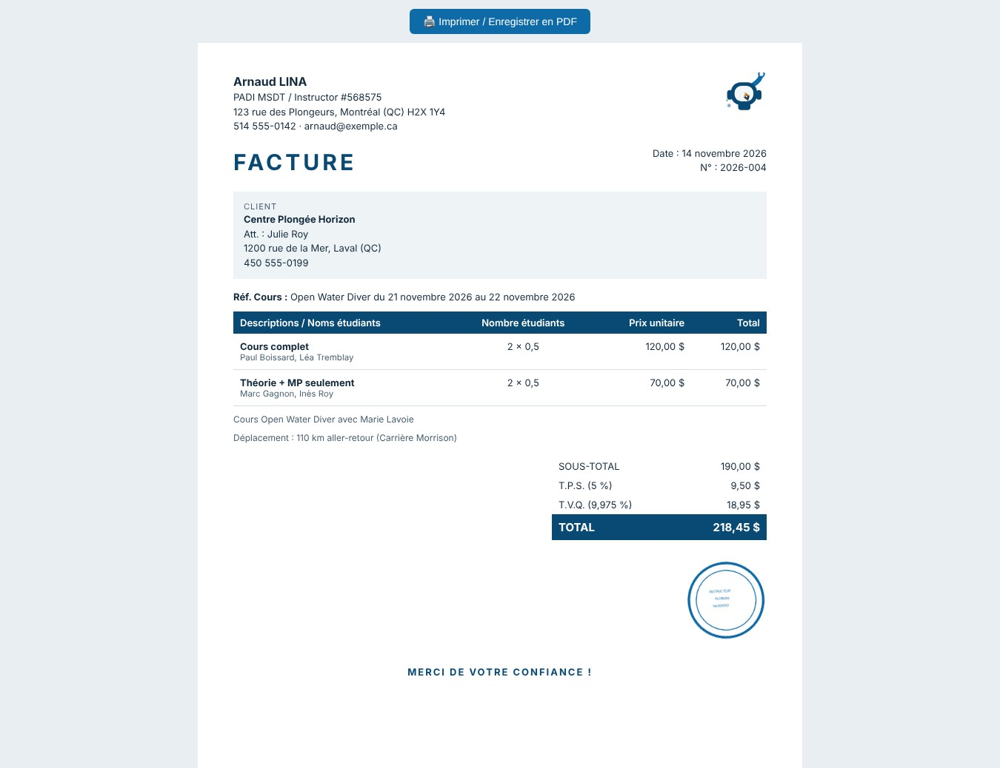
*La facture imprimée (format Letter)*


Le numéro suggéré n'avance que lorsque vous enregistrez une facture avec ce numéro ; si vous le modifiez à la main, le compteur n'est pas touché.

### 9.4 Suivi : soumise et payée

Dans l'éditeur de facture, la carte **« 5 · Suivi de la facture »** permet de dater deux étapes :

- **Soumise au centre** : cochez la case ; la date du jour est proposée, modifiable.
- **Payée** : même principe, avec la date de paiement.

Décochez une case pour effacer sa date. Ces changements **s'enregistrent automatiquement**. Le statut apparaît ensuite à côté du bouton « Facture » dans la fiche du cours et dans la colonne **Facture** du tableau de bord (— = aucune facture, *Brouillon*, *Soumise · date* en orange, *Payée · date* en vert). Un avertissement s'affiche si la date de paiement précède la date de soumission.

### 9.5 Cours non facturé

Chaque cours est **facturé par défaut**. Si vous ne facturez pas un cours (bénévolat, cours offert, cours facturé autrement), décochez **« Ce cours est facturé »** : à la création du cours, ou plus tard dans sa fiche, à côté de « Marquer le cours comme complété » (enregistré automatiquement).

Un cours non facturé :

- affiche **Non facturé** dans la colonne Facture du tableau de bord, et son bouton « Facture » disparaît ;
- ne produit **aucun rappel** de facture dans la liste « À faire » ;
- n'apparaît pas dans le suivi des factures ni dans ses totaux.

Le filtre **Facture → Non facturé** du tableau de bord permet de retrouver ces cours. Si une facture avait déjà été préparée, elle est conservée : recochez la case pour la retrouver.

### 9.6 Suivi des factures et export

Le menu **Factures** (ou la tuile **Paiements en attente** du tableau de bord) réunit toutes vos factures :

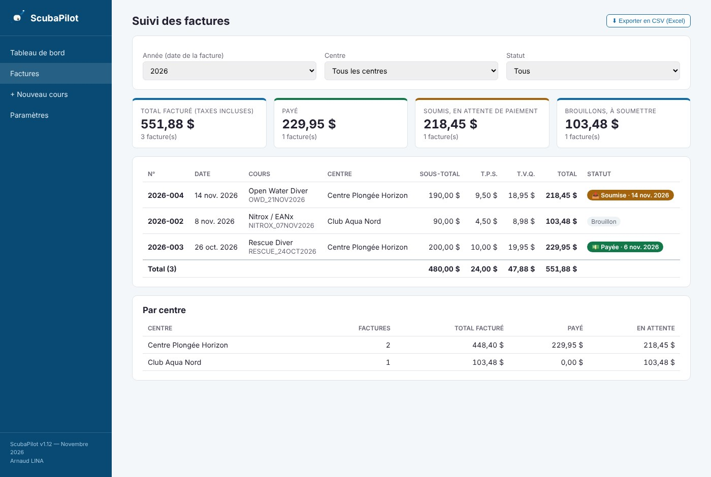
*Le suivi des factures : totaux, détail et répartition par centre*

- **Filtres** par année (date de la facture ; l'année en cours par défaut), par centre et par statut.
- **Quatre totaux** : facturé (taxes incluses), payé, soumis en attente de paiement, brouillons à soumettre.
- **Tableau détaillé** avec sous-total, T.P.S., T.V.Q. et total ; cliquez une ligne pour ouvrir le cours. Un tableau **par centre** s'ajoute quand plusieurs centres sont concernés.
- **⬇ Exporter en CSV (Excel)** : enregistre les factures affichées dans un fichier qui s'ouvre directement dans Excel (séparateur « ; », virgule décimale), pratique pour votre comptabilité ou la déclaration de taxes.

Dans la fenêtre « Courriel au centre » de l'éditeur de facture, le bouton **✔ Marquer la facture comme soumise** inscrit la date du jour comme date de soumission.

## 10. Rapports et sommaire

- **Rapport de cours** (fiche du cours → **🖨️ Exporter un rapport**) : séances, documents généraux et, pour chaque étudiant, coordonnées, âge, checklist détaillée, certification ou transfert, instructeur certificateur. Impression ou PDF depuis l'onglet qui s'ouvre.
- **Sommaire des activités accomplies** (tableau de bord, menu **⋯**) : tous vos cours (date, type, nombre d'étudiants, centre), du plus récent au plus ancien, avec totaux de cours et d'étudiants.

## 11. Paramètres en détail

| Carte | Contenu |
|---|---|
| Répertoire racine | Dossier où sont rangés cours et documents |
| Vos coordonnées | Nom, PADI, adresse, téléphone, courriel, CC et BCC par défaut |
| Centres partenaires | Centres qui vous mandatent (obligatoires pour créer un cours) |
| Facturation | Devise, taxes, pied de page, étampe, grilles de tarifs |
| Coéquipiers | Collègues et instructeurs (courriel, rôle) |
| Modèles d'email | Bibliothèque de modèles avec variables |
| Types de cours | Modèles de cours et leurs 4 listes de documents |
| Sites de plongée | Lieux utilisés dans les séances |
| Champs du profil étudiant | Champs du formulaire étudiant |
| Sauvegarde | Archive .zip du répertoire racine |
| À propos | Version, logo et apparence (clair, sombre, automatique) |

### Types de cours

Chaque type contient quatre listes de documents :

- `preDocs` / `postDocs` : documents à collecter **par étudiant**, avant et après le cours ;
- `generalPreDocs` / `generalPostDocs` : documents **généraux** du cours, cochés une fois pour tout le cours.

Chaque document a un libellé et une exigence : obligatoire, optionnel, conditionnel (coché à la main) ou, pour les documents par étudiant, **automatique (âge / statut)**. En choisissant « Automatique », un encadré **Nécessaire si :** apparaît sous la ligne : cochez « l'étudiant a moins de [18] ans au début du cours » et/ou les statuts concernés (voir [5.6](#56-statuts-de-documents-et-pourcentages)). Ne **changez pas l'identifiant** d'un document existant : il relie la case aux étudiants déjà cochés.

**Ordre des documents** : c'est l'ordre des cases dans la fiche de l'étudiant, les rapports et les courriels. Pour le changer :

- glissez une ligne par sa poignée **⠿** (à gauche) jusqu'à sa nouvelle place ;
- ou utilisez les flèches **↑** et **↓** ;
- pour ajouter un document à une place précise, cliquez sur **+** au bout de la ligne qui doit le précéder : la nouvelle ligne s'insère juste en dessous. « + Ajouter un document » l'ajoute à la fin.

Cliquez sur **Enregistrer** pour garder le nouvel ordre ; il s'applique aussi aux cours déjà créés. Déplacer ou renommer un document ne touche pas les cases déjà cochées.

### Champs du profil étudiant

Ajoutez, modifiez ou supprimez des champs ; choisissez le type (*Texte, Téléphone, Email, Date, Texte long, Liste déroulante*), le caractère obligatoire et, pour une liste, ses options. Gardez toujours **Prénom** et **Nom** : ils nomment les dossiers sur le disque. Le champ « Statut » pilote la certification ou le transfert de dossier.

### Apparence : mode clair ou sombre

En bas de la barre de gauche, le bouton **🌙 Mode sombre** / **☀️ Mode clair** passe d'un mode à l'autre. Dans **Paramètres → À propos**, la liste **Apparence** propose aussi **Automatique (comme Windows)** : ScubaPilot suit alors le réglage clair ou sombre de Windows, et change tout seul quand Windows change. C'est le choix par défaut.

Le choix est propre à **chaque ordinateur** (et à chaque navigateur). Les factures, leur aperçu et les pages imprimées restent toujours sur fond blanc.

### Logo

Le logo est le fichier `public/logo.svg`. Pour le remplacer, écrasez ce fichier en gardant le même nom.

## 12. Organisation des données sur le disque

```
<répertoire racine>/
  _ScubaPilot/          (vos réglages)
  _Corbeille/           (cours et étudiants supprimés)
  OWD_03OCT2026/
    course.json
    Photo/
    Paul BOISSARD/
      student.json
      (scans, photos, PDF…)
    Léa TREMBLAY/
      student.json
  RESCUE_05OCT2026/
    course.json
    …
```

- Un cours = un dossier `TYPE_DATE`. Un étudiant = un sous-dossier `Prénom NOM`.
- `course.json` et `student.json` sont gérés par l'application (la facture est enregistrée dans `course.json`). Ne les renommez pas.
- Les réglages (types de cours, centres, tarifs, modèles, etc.) sont rangés dans le dossier **`_ScubaPilot`** du répertoire racine : ils suivent vos cours et sont inclus dans la sauvegarde.

| Fichier | Contenu |
|---|---|
| `settings.json` | Vos coordonnées et préférences |
| `centers.json` | Centres partenaires |
| `buddies.json` | Coéquipiers |
| `course_types.json` | Types de cours et documents |
| `sites.json` | Sites de plongée |
| `student_fields.json` | Champs du profil étudiant |
| `email_templates.json` | Modèles d'email |
| `billing.json` | Devise, taxes, grilles de tarifs, compteur de factures |
| `stamp.json` | Image de l'étampe |

## 13. Sauvegarde

Paramètres → carte **Sauvegarde** → bouton de création. L'application crée un .zip de tout le répertoire racine, affiche l'avancement (fichiers et volume), puis le navigateur le télécharge. Si un fichier n'a pas pu être lu (verrouillé, ou seulement en ligne et impossible à télécharger), il est listé en rouge à la fin : il n'est pas dans la sauvegarde. Ce zip contient **tout** :

- vos cours, étudiants, documents et photos ;
- vos **réglages** (dossier `_ScubaPilot` : centres, tarifs, modèles d'email, types de cours, sites, étampe, coordonnées) ;
- la **corbeille** (dossier `_Corbeille`).

**Restaurer** : décompressez le zip dans un dossier, puis indiquez ce dossier comme répertoire racine dans les Paramètres. Les réglages qu'il contient sont repris automatiquement.

**Rappel de sauvegarde.** La carte Sauvegarde indique la date de la dernière sauvegarde téléchargée (commune à tous les ordinateurs qui partagent votre répertoire racine). Tant qu'aucune n'a été faite, puis dès que la dernière a plus de 30 jours, la liste « À faire » du tableau de bord vous le rappelle (en rouge au-delà de 90 jours). Rangez chaque sauvegarde hors de l'ordinateur : clé USB, disque externe.

### Copies en conflit de OneDrive

Si un fichier de ScubaPilot est modifié à deux endroits avant que OneDrive ait fini de synchroniser (deux ordinateurs, ou un ordinateur resté hors ligne), OneDrive garde les deux versions et renomme l'une en ajoutant le nom de l'ordinateur, par exemple `student-BUREAU-PC.json` à côté de `student.json`. ScubaPilot ne lit que `student.json` : les changements de la copie n'apparaissent pas.

La liste « À faire » signale chaque copie de ce genre, avec un bouton **Ouvrir le dossier**. Le plus simple : vérifiez dans ScubaPilot que la fiche (ou le cours, ou le réglage) est correcte, corrigez au besoin, puis supprimez la copie dans l'Explorateur.

### Corbeille

Un cours ou un étudiant supprimé n'est pas effacé : il est déplacé dans le dossier `_Corbeille` du répertoire racine, avec tous ses documents. Dans **Paramètres → Corbeille** :

- **↩ Restaurer** remet l'élément à sa place. Un étudiant ne peut être restauré que si son cours existe : restaurez d'abord le cours s'il est lui aussi dans la corbeille.
- **Supprimer définitivement** efface l'élément pour de bon.
- **Vider la corbeille** efface tout son contenu (il faut taper `VIDER` pour confirmer).

La corbeille ne se vide jamais toute seule.

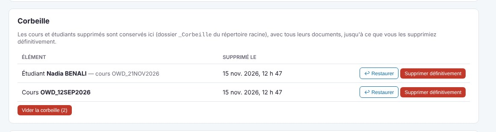
*Paramètres : la corbeille, avec un étudiant et un cours supprimés*

### Si un fichier est signalé « illisible »

Si une écriture est interrompue (panne, conflit de synchronisation OneDrive), un fichier `course.json` ou `student.json` peut devenir illisible. ScubaPilot l'indique alors par un badge rouge **⚠ Fichier illisible** (tableau de bord) ou **⚠ Fiche illisible** (étudiant) et **refuse toute modification** de ce fichier, pour ne pas écraser son contenu. Vos documents ne sont pas touchés. Pour réparer : dans l'Explorateur, clic droit sur le fichier → **Historique des versions** (OneDrive) et restaurez la version précédente, ou reprenez le fichier d'une sauvegarde ; rechargez ensuite la page.

Conseil : sauvegardez avant toute suppression de cours et avant chaque mise à jour.

## 14. Mise à jour de l'application

Depuis la version 1.8, vos réglages ne sont plus dans le dossier de l'application : ils sont rangés avec vos cours, dans le dossier `_ScubaPilot` du répertoire racine. Le chemin du répertoire racine, lui, est mémorisé dans votre profil Windows. Une mise à jour se résume donc à remplacer le dossier de l'application :

1. **Remplacez tout le dossier de l'application** par le nouveau (au même endroit, pour que le raccourci de démarrage reste valable). Si Windows refuse parce que des fichiers sont utilisés, lancez d'abord `Arreter.bat`.
2. Double-cliquez sur **`Lancer ScubaPilot.bat`** : il installe les composants si besoin, arrête l'ancienne version si elle tournait encore, et démarre la nouvelle.
3. Rechargez la page (`Ctrl + F5`). Vérifiez le numéro de version en bas de la barre latérale, ou dans **Paramètres → Emplacements**.

**Première mise à jour vers la 1.8 (une seule fois)** : recopiez encore votre ancien dossier `data` dans le nouveau dossier avant de lancer l'application. Au démarrage, elle déplace elle-même vos réglages vers le répertoire racine. Si vous avez oublié cette étape et que vos centres ou tarifs ont disparu : **Paramètres → Emplacements → Importer les réglages d'une ancienne installation**, puis indiquez l'ancien dossier de l'application.

### Archivage des anciens cours (conservation des dossiers)

Les dossiers d'étudiants contiennent des renseignements personnels et médicaux : il est prudent de ne pas les garder plus longtemps que nécessaire, sans les détruire trop tôt. Dans **Paramètres → Archivage des anciens cours** :

- **Durée de conservation** : **5 ans par défaut**, jamais moins ; vous pouvez l'allonger. Elle se compte à partir de la **dernière séance** du cours.
- La carte liste les cours qui ont dépassé cette durée. La liste « À faire » du tableau de bord le rappelle aussi, sans urgence.
- **Rien n'est jamais archivé ni supprimé automatiquement.** Cochez les cours voulus, puis :
  - **🗄️ Archiver la sélection** : chaque cours est enregistré dans un fichier zip complet (dossier `_Archives` du répertoire racine), puis retiré des listes. Le zip est vérifié avant que le cours ne soit retiré ; si un fichier est illisible (par exemple un fichier OneDrive pas téléchargé), le cours n'est pas archivé et vous êtes prévenu.
  - **Supprimer la sélection** : le cours est retiré sans zip (il faut taper `SUPPRIMER` pour confirmer).
- Dans les deux cas, le dossier d'origine passe par la **corbeille** : il n'est détruit pour de bon que lorsque vous la videz.
- **Consulter un cours archivé** : ouvrez son zip. **Le remettre dans ScubaPilot** : extrayez le zip dans le répertoire racine, le dossier du cours y est recréé.

Les archives font partie du répertoire racine : elles sont incluses dans la sauvegarde et synchronisées par OneDrive.

### Emplacements

La carte **Paramètres → Emplacements** indique où se trouvent le dossier de l'application en cours d'exécution, les réglages, la corbeille et le fichier qui mémorise le chemin de la racine. C'est le premier endroit à regarder si l'application ne semble pas à jour : le chemin « Application » montre quelle copie tourne réellement.

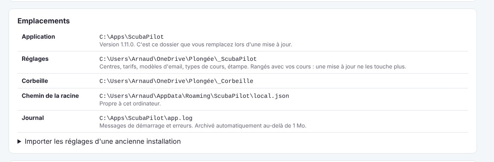
*Paramètres : emplacements de l'application, des réglages, de la corbeille et du journal*

### Si le répertoire racine est introuvable

Si OneDrive n'a pas fini de démarrer, si un disque n'est pas branché ou si le dossier a été déplacé, ScubaPilot affiche « Répertoire racine introuvable » au lieu d'un tableau de bord vide. Cliquez sur **Réessayer**, ou indiquez le nouvel emplacement du dossier.

## 15. Dépannage

**La page ne s'ouvre pas à `localhost:4531`.** L'application n'est pas démarrée : lancez `Lancer ScubaPilot.bat` et lisez le message affiché. Avec le démarrage automatique, consultez `app.log`.

**« node n'est pas reconnu… »** Node.js n'est pas installé ou la session doit être rouverte : réinstallez Node.js puis rouvrez l'invite de commande.

**« Cannot find module 'express' ».** Les dépendances ne sont pas installées : exécutez `npm install` dans le dossier de l'application.

**Le port 4531 est déjà utilisé.** Si c'est par ScubaPilot, `Lancer ScubaPilot.bat` s'en occupe tout seul. Si c'est par un autre programme, le message de lancement le dit : fermez ce programme ou redémarrez l'ordinateur.

**Après une mise à jour, je ne vois pas les nouveautés.** Rechargez sans cache (`Ctrl + F5`). Vérifiez que `public/` a bien été remplacé en entier et que le numéro de version en bas de la barre latérale est le bon.

**« Répertoire racine non défini ».** Allez dans Paramètres, indiquez le répertoire racine et enregistrez.

**Je choisis un lieu (ou un centre, un coéquipier) et un autre s'affiche à sa place.** Deux éléments de la liste portaient le même identifiant, en général après une modification à la main d'un fichier de `_ScubaPilot`. Depuis la version 1.18.1, ScubaPilot le corrige tout seul : le premier garde son identifiant, l'autre en reçoit un nouveau, et le fichier d'origine est copié dans `_ScubaPilot/_avant-correction-<date>/`. Les séances déjà enregistrées avec cet identifiant restent rattachées au premier élément : ouvrez-les et choisissez le bon lieu si nécessaire.

**Je ne peux pas créer de cours.** Il faut au moins un centre partenaire (Paramètres → Centres).

**La facture ou le rapport ne s'ouvre pas.** Le navigateur bloque la fenêtre : autorisez les popups pour `localhost`.

**Le logo ou l'étampe n'apparaît pas sur la facture.** Vérifiez que la case correspondante est cochée sur la facture et que l'image d'étampe est bien enregistrée (Paramètres → Facturation). Le PDF doit être généré depuis l'onglet de la facture.

**Mon pourcentage de documents semble faux.** Rouvrez la fiche de l'étudiant : le calcul se fait à partir des documents du type de cours.

**La case « Certification confirmée » est grisée.** Choisissez d'abord un instructeur certificateur.

**Je ne vois pas « Transfert de dossier ».** Il n'apparaît que pour un étudiant en « cours seulement » ; vérifiez son statut et rechargez la page (`Ctrl + F5`).

**Un étudiant est « en double » entre deux cours.** C'est normal : chaque cours garde son dossier étudiant ; la fiche globale les réunit grâce à l'identifiant de l'étudiant.

**La fiche globale d'un étudiant ne montre pas tous ses cours.** Les fiches n'ont ni courriel ni date de naissance en commun, donc ScubaPilot les a gardées séparées. Ouvrez sa fiche globale : l'encadré « même nom » propose de les fusionner.

## 16. Notes techniques

- Serveur Node.js (Express) uniquement local, sur `localhost:4531` ; rien n'est envoyé sur internet.
- **Protection contre les autres sites web** (depuis la version 1.17) : une page web ouverte dans votre navigateur ne peut pas envoyer d'ordre à ScubaPilot. Toute modification doit venir de l'interface de ScubaPilot elle-même (en-tête `X-ScubaPilot` et vérification de l'origine).
- **Accès limité à cet ordinateur** (depuis la version 1.7) : le serveur n'écoute que sur `127.0.0.1` et refuse les requêtes venant d'un autre appareil du réseau. L'application n'ayant pas de mot de passe, c'est ce qui protège vos dossiers sur un Wi-Fi partagé.
- Les fichiers de données sont écrits de façon atomique (fichier temporaire puis renommage) : une coupure laisse l'ancienne version intacte.
- Interface en JavaScript pur (sans framework), données en fichiers JSON : aucune base de données à installer.
- **Versions des composants figées** (depuis la version 1.17) : le fichier `package-lock.json` fixe la version exacte de chaque composant installé par `npm install` (Express et ses dépendances), avec une empreinte de contrôle ; deux installations obtiennent exactement les mêmes.
- **Tests automatiques** (depuis la version 1.14) : une centaine de vérifications couvrent les réglages, les cours et étudiants, la sécurité des chemins, les fichiers illisibles, la corbeille, le dépôt de fichiers, la sauvegarde zip, le lanceur, le démarrage automatique et les calculs de l'interface (statuts, liste « À faire », factures, import, calendrier). Elles démarrent le vrai programme sur un port à part, avec un répertoire racine temporaire : vos données ne sont jamais touchées. Pour les lancer vous-même : `npm test` dans le dossier de l'application. Elles tournent aussi sur GitHub à chaque mise à jour du dépôt, sous Windows et sous Linux.
- Le bouton « Ouvrir dans l'Explorateur » utilise la commande Windows `explorer`. La sauvegarde est écrite par l'application elle-même (format zip standard, ZIP64 au-delà de 4 Go) : plus de PowerShell ni de limite de 2 Go.
- Les fichiers déposés sont copiés en flux : il n'y a plus de limite pratique de taille (garde-fou à 8 Go par fichier), avec un pourcentage d'avancement pour les gros fichiers.
- Les fichiers statiques sont servis sans cache, et les scripts sont référencés avec un numéro de version pour éviter les anciennes copies.
- Code source : <https://github.com/almtlsandbox/scubapilot> (dépôt privé).
